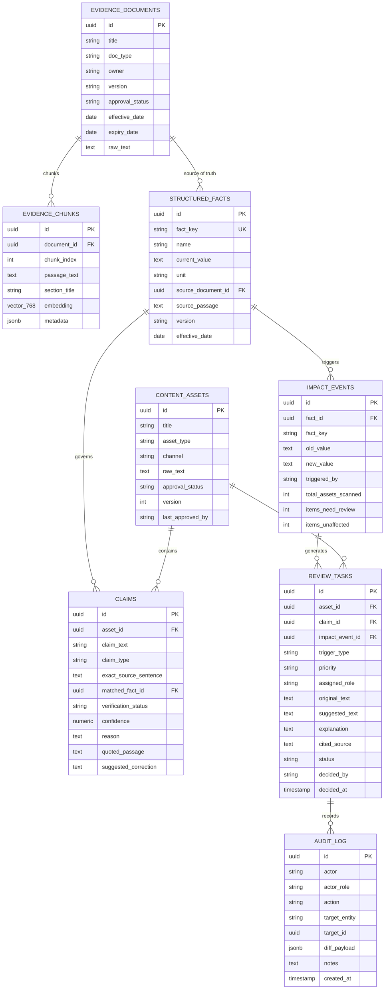

# System Architecture & Data Model

Proofline is an evidence-backed brand-governance platform.  
**Tagline:** *"When facts change, know exactly what needs to change."*

---

## 1. Layered System Architecture

The Proofline platform is organized into four distinct, loosely coupled layers matching the Round 1 architectural commitment:

```
+-----------------------------------------------------------------------------------+
|                            EXPERIENCE LAYER (Next.js / React)                     |
|  • Responsive Web App (Tailwind CSS, Navy #0B1B33, Teal #2BC4C4, Amber #F5A623)   |
|  • Brand Governance Dashboard & Health Score Telemetry                            |
|  • Change Impact Visualizer (Interactive 3-Column Dependency Graph)               |
|  • Human Review Centre (Side-by-side Diff Viewer, Approve / Reject / Edit)        |
|  • Role Switcher Viewport (Admin, Legal Reviewer, Brand Manager, Content Creator) |
+-----------------------------------------------------------------------------------+
                                         |
                                         | REST / JSON APIs
                                         v
+-----------------------------------------------------------------------------------+
|                        APPLICATION LAYER (FastAPI / Python)                       |
|  • FastAPI REST Endpoints (Document upload, claim scan, fact change, reviews)     |
|  • Role-Based Access Control (Supabase Auth / JWT / Role Gate Enforcement)        |
|  • Asynchronous Background Jobs (FastAPI BackgroundTasks for MVP document parsing)|
|  • Audit Ledger Service (Chronological, immutable governance trail)               |
+-----------------------------------------------------------------------------------+
                                         |
                                         | Verification & Graph Queries
                                         v
+-----------------------------------------------------------------------------------+
|                         INTELLIGENCE LAYER (Hybrid Engine)                        |
|  • Claim Intelligence: Typed claim extraction (numeric, comparative, date, promo) |
|  • Stage 1 Verification: Deterministic exact-value & unit comparison (zero drift) |
|  • Stage 2 Verification: Google Gemini grounded verification & citation quotes    |
|  • Change Impact Engine: Dependency graph traversal (Fact -> Claims -> Assets)     |
+-----------------------------------------------------------------------------------+
                                         |
                                         | Vector Search & Relational Storage
                                         v
+-----------------------------------------------------------------------------------+
|                             DATA LAYER (PostgreSQL & pgvector)                    |
|  • PostgreSQL Tables: facts, claims, content_assets, review_tasks, audit_log      |
|  • pgvector Extension: 768-dim embeddings for evidence chunk retrieval            |
|  • Multi-Format Document Ingestion: PyMuPDF (PDF), python-docx (DOCX), plain text |
+-----------------------------------------------------------------------------------+
```

---

## 2. Core Data Model & Relational Schema

Proofline’s schema is implemented in PostgreSQL with the `pgvector` and `uuid-ossp` extensions:



---

## 3. The Change Impact Engine Workflow

The signature engine executes when any approved business fact is revised:

```
[1. User Edits Fact]
        |
        v  (e.g., Warranty 2 years -> 1 year in Warranty Policy v3)
[2. Delta & Graph Walk]
        |
        +---> Query all claims linked to Fact ID
        |
[3. Exact Check First (Stage 1)]
        |
        |---> Compare exact numbers & units (2.0 vs 1.0)
        |---> If identical or unrelated: Mark claim as "checked, not affected"
        |---> If conflicting: Mark claim as "outdated"
        |
[4. LLM Semantic & Grounded Check (Stage 2)]
        |
        |---> Retrieve evidence passage & generate context-preserving correction
        |
[5. Cascade Invalidation]
        |
        |---> Affected Assets: approval_status set to "approval_invalidated"
        |---> Unaffected Assets: marked safe, status untouched
        |
[6. Review Task Generation]
        |
        |---> Auto-create ReviewTask in Review Centre with red/green diff & citation
        |
[7. Audit Ledger Commitment]
        |
        +---> Record FACT_UPDATED, APPROVAL_INVALIDATED, and audit trail
```

---

## 4. Human-in-the-Loop Principle

At no point does the system auto-apply fixes to live content assets. The AI acts strictly as an advisory intelligence engine:
1. **AI Proposes:** Identifies exact conflicts, quotes the approved source passage, and suggests a non-destructive edit.
2. **Human Decides:** An authorized Reviewer or Admin must explicitly click **Approve**, **Reject**, or **Edit**.
3. **Decisions Are Audited:** The actor's identity, timestamp, role, and before/after text are committed to the immutable audit log.
